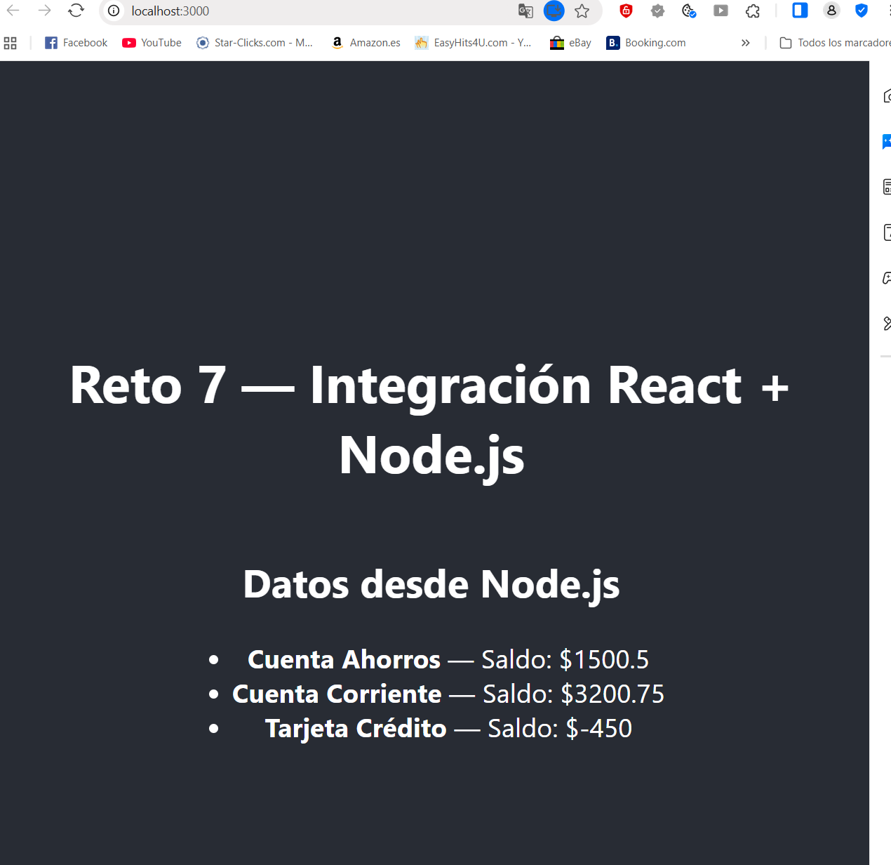

# Reto 7 — Integración de React con una API RESTful en Node.js


## 📌 Descripción

Aplicación web que demuestra la integración entre un frontend desarrollado en **React** (Create React App) y un backend en **Node.js + Express** que expone una API RESTful con datos estáticos.

React consume el endpoint `/api/data` mediante `fetch` y muestra la información en pantalla.

---

## 🛠️ Tecnologías utilizadas

| Capa | Tecnología |
|------|------------|
| Frontend | React 18 (Create React App) |
| Backend | Node.js + Express |
| Comunicación | Fetch API + CORS |
| Estilos | CSS de CRA |

---
```
## 📁 Estructura del proyecto


Reto7_Integ_React_en_APPNodejs/
├── package.json # Scripts raíz (concurrently)
├── README.md # Este archivo
├── backend/
│ ├── package.json
│ └── server.js # Servidor Express
└── frontend/
├── package.json
└── src/
├── App.js
└── DataList.js # Componente que consume la API
```


---

## 🚀 Instalación y ejecución

### 1. Clonar el repositorio

```bash
git clone https://github.com/TU_USUARIO/Reto7_Integ_React_en_APPNodejs.git
cd Reto7_Integ_React_en_APPNodejs
```
2. Instalar dependencias
bash
# Raíz (concurrently)
npm install

# Backend
cd backend && npm install && cd ..

# Frontend
cd frontend && npm install && cd ..
O en un solo comando si configuraste el script:

bash
npm run install-all
3. Ejecutar backend y frontend simultáneamente
bash
npm run dev
Esto levanta:

Backend: http://localhost:5000

Frontend: http://localhost:3000

🔌 Endpoints de la API
Método	Ruta	Descripción
GET	/api/data	Devuelve datos estáticos (cuentas bancarias)
GET	/api/health	Verifica el estado del servidor
Ejemplo de respuesta /api/data
json
{
  "message": "Hello from server!",
  "data": [
    { "id": 1, "nombre": "Cuenta Ahorros", "saldo": 1500.50 },
    { "id": 2, "nombre": "Cuenta Corriente", "saldo": 3200.75 },
    { "id": 3, "nombre": "Tarjeta Crédito", "saldo": -450.00 }
  ]
}
🧩 Cómo funciona la integración
React se inicia en el puerto 3000.

El componente DataList.js ejecuta fetch('http://localhost:5000/api/data') dentro de un useEffect.

El servidor Express responde con un JSON.

React guarda los datos en el estado con useState y los renderiza en una lista.

El middleware cors permite la comunicación entre puertos distintos.

## 🖼️ Vista previa



✅ Cumplimiento de la guía de evaluación
☑ Proyecto React creado con Create React App
☑ Servidor Node.js con Express configurado
☑ API RESTful con endpoint /api/data
☑ Uso de fetch en React para consumir la API
☑ Visualización de datos en componentes React
☑ Ejecución simultánea de React y Node
☑ Código fuente subido a GitHub
☑ Documentación detallada (este README)
🧠 Buenas prácticas aplicadas (10 mandamientos Zend)
Planificación previa de la estructura backend/frontend.

Mejores prácticas de desarrollo (separación de responsabilidades).

Enfoque modular (DataList.js independiente).

Código limpio y documentado.

Pruebas exhaustivas en navegador y consola.

Entorno de producción adecuado (puertos definidos).

Monitorización mediante logs del servidor.

Pruebas y correcciones durante el desarrollo.

Actualización a versiones recientes de React/Express.

Documentación de todas las modificaciones.

👤 Autor
Judit Giravent
Curso: Desarrollo Web con Frameworks — Código Samurái
Año: 2026

📄 Licencia
ISC